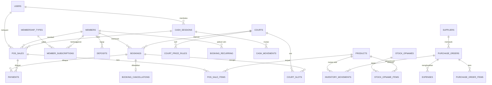

# Desain Sistem Pengelolaan Lapangan Badminton

**Nama produk (usulan):** SmashBook / CourtFlow
**Versi dokumen:** 1.0
**Tanggal:** 18 Oktober 2026
**Status:** Draf untuk persetujuan klien

---

## 1. Ringkasan Eksekutif

Sistem ini adalah aplikasi operasional harian untuk pengelolaan gedung olahraga badminton (GOR) dengan
6 modul inti: **Member**, **Booking Lapangan**, **POS Penjualan**, **Kas Harian**, **Quick PO
(pengadaan & biaya operasional)**, dan **Stock Barang**.

Sasaran utama bukan sekadar mencatat, melainkan:

1. **Menghilangkan double booking** dan bentrok jadwal antar-operator.
2. **Menutup kebocoran kas** lewat sesi kas per shift dengan rekonsiliasi otomatis.
3. **Mengetahui profitabilitas riil** per lapangan, per jam, dan per lini pendapatan (sewa vs F&B/POS).
4. **Mengendalikan stok & pembelian** agar tidak kehabisan shuttlecock/air minum saat jam sibuk.

Prinsip desain: **satu sumber kebenaran (single source of truth)**. Semua aliran uang masuk
(booking, POS, penjualan membership) otomatis menjadi mutasi kas harian, dan semua barang keluar
(POS, pemakaian internal) otomatis mengurangi stok. Tidak ada pencatatan ganda.

---

## 2. Ruang Lingkup

### 2.1 Dalam lingkup (fase 1)

| # | Modul | Cakupan |
|---|-------|---------|
| M1 | Kelola Member | Master member, tipe/paket membership, masa aktif, saldo deposit, riwayat booking & transaksi |
| M2 | Pesan & Booking Lapangan | Papan jadwal, booking walk-in & member, tarif peak/off-peak, recurring booking, check-in, pembatalan, no-show |
| M3 | POS Penjualan | Penjualan air minum, shuttlecock, sewa raket, jasa stringing; multi-metode bayar; diskon member; cetak struk |
| M4 | Kas Harian | Sesi kas per shift, modal awal, mutasi kas masuk/keluar, tutup shift + selisih kas, setoran |
| M5 | Quick PO | Purchase order cepat, item produk *atau* biaya/jasa, approval berjenjang, penerimaan barang, biaya operasional |
| M6 | Stock Barang | Kartu stok, stok masuk/keluar, stock opname, minimum stok & reorder alert, HPP rata-rata |

**Modul pendukung (harus ada, bukan modul bisnis):** Autentikasi & RBAC, Master Lapangan & Tarif,
Master Supplier, Laporan, Pengaturan (jam operasional, kebijakan pembatalan, threshold approval),
Audit Log, Nomor dokumen otomatis.

### 2.2 Di luar lingkup (fase lanjutan)

- Aplikasi mobile native (fase 2 → PWA).
- **Halaman pemesanan online untuk publik** — tidak diperlukan. Booking hanya diterima melalui
  telepon/WhatsApp dan kunjungan langsung, sehingga tidak ada antarmuka yang dapat diakses pelanggan
  tanpa perantara operator.
- **Integrasi pembayaran otomatis (payment gateway)** — tidak digunakan. Seluruh pembayaran
  non-tunai (QRIS, transfer, kartu) dicatat manual oleh kasir dan diverifikasi dari mutasi rekening
  atau mesin EDC milik GOR.
- Turnamen/liga, pembagian poin, sistem coaching/akademi.
- Payroll, akuntansi penuh (jurnal umum, neraca), integrasi e-Faktur.
- Multi-venue (multi cabang) — model data dirancang siap, UI fase 2.

### 2.3 Batasan Platform

Sistem dijalankan pada **shared hosting Hostinger milik pengelola** — bukan pada server lokal di GOR.
Konsekuensi berikut sudah diperhitungkan dalam desain:

- Tidak ada layanan realtime (WebSocket): papan jadwal memuat ulang saat dibuka atau di-refresh
  manual. Keamanan jadwal tidak bergantung pada realtime — pencegahan bentrok tetap divalidasi di server.
- Tugas terjadwal dijalankan oleh **cron Hostinger** (interval per menit), bukan daemon permanen.
- Pencadangan data dilakukan lewat tugas terjadwal sendiri, tidak mengandalkan fitur bawaan paket.
- Aplikasi sepenuhnya bergantung pada koneksi internet lokasi, sehingga **mode offline POS menjadi
  pengembangan lanjutan prioritas pertama**.

---

## 3. Aktor & Hak Akses (RBAC)

| Peran | Deskripsi | Ringkas hak akses |
|-------|-----------|-------------------|
| **Owner** | Pemilik/pengawas | Semua akses, approval PO, buka/tutup kas, lihat harga beli & margin, pengaturan |
| **Admin** | Kepala operasional | Master data, PO, stok, laporan, buka/tutup kas; **tanpa** pengaturan tarif global & approval di atas threshold |
| **Kasir** | Front office | POS, pembayaran, booking, kas shift-nya sendiri, lihat member |
| **Operator Lapangan** | Jaga lapangan | Jadwal lapangan, check-in/out, booking walk-in; **tidak** melihat harga beli, HPP, dan laporan keuangan |

Matriks izin detail (ringkas):

| Fungsi | Owner | Admin | Kasir | Operator |
|--------|:-----:|:-----:|:-----:|:--------:|
| Booking: buat/ubah/batal | ✅ | ✅ | ✅ | ✅ (walk-in saja) |
| Booking: override tarif / komplimen | ✅ | ✅ | ⚠️ butuh PIN owner | ❌ |
| POS: transaksi & refund | ✅ | ✅ | ✅ | ❌ |
| POS: void transaksi harian | ✅ | ✅ | ⚠️ butuh PIN owner | ❌ |
| Kas: buka/tutup shift sendiri | ✅ | ✅ | ✅ | ✅ (bila ditugaskan) |
| Kas: lihat semua shift & selisih | ✅ | ✅ | ❌ | ❌ |
| Stock: lihat qty | ✅ | ✅ | ✅ | ⚠️ terbatas |
| Stock: lihat harga beli/HPP | ✅ | ✅ | ❌ | ❌ |
| PO: buat | ✅ | ✅ | ❌ | ❌ |
| PO: setujui | ✅ | ⚠️ ≤ threshold | ❌ | ❌ |
| Laporan keuangan | ✅ | ✅ | ⚠️ shift sendiri | ❌ |
| Pengaturan sistem | ✅ | ❌ | ❌ | ❌ |

> Semua aksi sensitif (void, diskon > batas, ubah tarif, tutup shift dengan selisih) tercatat di **audit log**
> beserta user, waktu, nilai sebelum/sesudah, dan alasan.

---

## 4. Arsitektur Modul

```
                    ┌──────────────────────────────────────────────┐
                    │            ANTARMUKA (Web / PWA)             │
                    │  Dashboard · Jadwal · POS · Kas · Stok · PO  │
                    └───────────────────────┬──────────────────────┘
                                            │
     ┌──────────────────────────────────────┴───────────────────────────────────┐
     │                      LAPISAN APLIKASI (Service Layer)                    │
     │ BookingService · PosService · CashService · InventoryService · PoService │
     │ AuthService/RBAC · ReportService · NotificationService (teks manual)     │
     └───────┬──────────────┬───────────────┬──────────────┬────────────────────┘
             │              │               │              │
      ┌──────▼─────┐ ┌──────▼─────┐  ┌──────▼─────┐ ┌──────▼──────┐
      │ M2 Booking │ │  M3 POS    │  │ M4 Kas     │ │ M5 PO       │
      │ M1 Member  │ │            │  │ Harian     │ │ M6 Stock    │
      └──────┬─────┘ └──────┬─────┘  └──────┬─────┘ └──────┬──────┘
             └──────────────┴───────────────┴──────────────┘
                                    │
                    ┌───────────────▼────────────────┐
                    │  DATABASE (MySQL/PostgreSQL)   │
                    │  + Audit Log + Job Scheduler   │
                    └───────────────┬────────────────┘
                                    │
        ┌───────────────┬───────────┴────────┬─────────────────┐
   ┌────▼────┐    ┌─────▼─────┐       ┌──────▼──────┐   ┌──────▼──────┐
   │ Printer │    │ QRIS /    │       │ WhatsApp    │   │ Backup      │
   │ Thermal │    │ EDC       │       │ (manual)    │   │ Harian      │
   └─────────┘    └───────────┘       └─────────────┘   └─────────────┘
```

**Aliran data kunci (one-way, tidak ada input ganda):**

- `Bayar Booking` → mengisi `payments` → auto-generate `cash_movements` (jika tunai) → ikut ke `cash_sessions`.
- `Transaksi POS` → `pos_sales` + `pos_sale_items` → `inventory_movements (OUT)` → `cash_movements` bila tunai.
- `Penerimaan PO` → `inventory_movements (IN)` untuk item produk; untuk item jasa/biaya → `expenses` → `cash_movements (OUT)`.
- `Stock Opname` → `inventory_movements (ADJUST)` + catatan variance.

---

## 5. Modul 1 — Kelola Member

### 5.1 Kebutuhan
- Pendaftaran member (nama, no. HP/WhatsApp, email, tanggal lahir, alamat, foto opsional).
- Kategori member: **Non-Member / Reguler / Member Bulanan / Member Korporat / Komunitas Klub**.
- Paket membership: durasi (30/90/180/365 hari), harga, benefit (diskon sewa %, kuota jam gratis/bulan, prioritas booking).
- Masa aktif otomatis dihitung; sistem menandai H-7 dan H-1 sebelum habis pada daftar pengingat
  (dikirim manual oleh petugas melalui WhatsApp).
- **Saldo deposit** (opsional): member bisa top-up, saldo dipakai untuk bayar booking/POS.
- Kartu member dengan QR/kode unik untuk scan cepat saat check-in.
- Riwayat: total booking, total belanja POS, frekuensi terakhir bermain, no-show count.

### 5.2 Aturan bisnis
1. Satu nomor HP = satu akun member aktif (validasi duplikat).
2. Perpanjangan membership saat masih aktif → masa aktif **ditambahkan** dari tanggal berakhir, bukan dari hari ini.
3. Diskon member diterapkan pada tarif sewa; diskon tidak berlaku untuk produk dengan harga dasar (mis. shuttlecock) kecuali paket menyatakan lain.
4. **3× no-show** dalam 30 hari → status `perlu_konfirmasi`: booking berikutnya butuh DP.
5. Member dengan tunggakan/booking belum dibayar tidak bisa membuat booking baru tanpa pelunasan.
6. Status member: `aktif`, `akan_expired` (H-7), `expired`, `suspend`, `blacklist`.

### 5.3 Layar
Daftar Member (tabel + filter + pencarian) · Form Member (drawer) · Detail Member (tab: Profil, Membership, Booking, Transaksi, Deposit) · Paket Membership.

---

## 6. Modul 2 — Pesan & Booking Lapangan

### 6.1 Kebutuhan
**Kanal booking hanya tiga:** **telepon**, **WhatsApp**, dan **kunjungan langsung**. Tidak ada
halaman pemesanan mandiri untuk pelanggan — seluruh entri jadwal dilakukan oleh operator/kasir.

- **Papan jadwal** berbentuk grid `Jam × Lapangan` per tanggal (paling mudah dibaca operator), plus tampilan daftar.
- Booking **walk-in** (langsung main) dan booking **di muka** (H-1 s/d H+14 untuk umum, H+30 untuk member).
- Pilih durasi kelipatan 30 menit; sistem menghitung harga otomatis dari **aturan tarif** (peak/off-peak).
- Booking **berulang (recurring)**: misalnya "komunitas A setiap Selasa 19:00–21:00 selama 3 bulan".
- Status booking: `draft` → `hold` → `confirmed` → `checked_in` → `completed`, serta `cancelled` / `no_show` / `expired`.
- Pembayaran: DP (mis. 50%), lunas di muka, atau bayar di tempat (khusus member terpercaya).
- Check-in: scan QR/kartu member atau cari nama; check-out menutup durasi aktual (bisa berbeda dari rencana).
- Pembatalan dengan kebijakan refund bertingkat.
- Pengingat jadwal: sistem menyiapkan daftar dan teks pesan untuk H-1 serta H-3 jam; pengiriman
  dilakukan petugas melalui WhatsApp (manual, tanpa layanan pihak ketiga).
- Penanganan **overbooking** yang mustahil terjadi (lihat 6.3) dan **hold sementara** saat pelanggan masih di telepon.

### 6.2 Struktur tarif (configurable)

| Kategori | Hari | Jam | Tarif/jam (contoh) |
|----------|------|-----|--------------------|
| Off-Peak | Senin–Jumat | 07:00–16:00 | Rp 60.000 |
| Prime | Senin–Jumat | 16:00–22:00 | Rp 90.000 |
| Night | Senin–Jumat | 22:00–24:00 | Rp 75.000 |
| Weekend/Holiday | Sabtu, Minggu, hari libur nasional | 07:00–24:00 | Rp 100.000 |

- Tarif bisa berbeda per lapangan (mis. Lapangan 1 & 2 karpet premium +20%).
- Booking melewati batas kategori (mis. 15:00–17:00) dihitung **per-slot 30/60 menit** sesuai kategori masing-masing.
- Diskon member % diambil dari paket; **promo jam sepi** (mis. diskon 30% sebelum jam 14:00 pada hari kerja) dapat dijadwalkan.

### 6.3 Strategi anti double-booking (WAJIB)

Tiga lapis pertahanan:

1. **Tabel slot**: `court_slots (court_id, slot_date, slot_hour, booking_id)` dengan `UNIQUE (court_id, slot_date, slot_hour)`.
   Setiap booking mengisi baris slot per jam. Database menolak baris duplikat secara fisik.
2. **Transaksi + row lock**: proses booking dibungkus DB transaction dengan `SELECT ... FOR UPDATE` pada slot yang dituju, sehingga dua kasir yang menekan "Simpan" bersamaan akan berurutan, bukan bersamaan.
3. **UI**: slot yang terisi tampil non-klik; validasi ulang di server sebelum commit (jangan pernah percaya validasi di browser).

Booking `draft/hold` mengisi slot dengan flag sementara + `expires_at` (15 menit); scheduler melepas hold yang kedaluwarsa.

### 6.4 Kebijakan pembatalan (default, configurable)
| Waktu batal sebelum jadwal | Refund |
|---|---|
| ≥ 24 jam | 100% (atau pindah jadwal gratis) |
| 6–24 jam | 50% |
| < 6 jam | 0% (hangus) |
| No-show | 0%, tercatat sebagai pelanggaran |

### 6.5 Layar
Papan Jadwal · Daftar Booking (hari ini / minggu) · Form Booking (modal dengan kalkulasi harga live) · Check-in/out · Booking Berulang · Kebijakan & Tarif.

---

## 7. Modul 3 — POS Penjualan

### 7.1 Kebutuhan
- Katalog produk dalam grid besar (ramah sentuh): air mineral, minuman isotonik, kopi sachet, shuttlecock, grip, kaos, sewa raket, jasa stringing/senar.
- Keranjang, ubah qty, hapus item, **diskon** (nominal/%/per item) dengan batas izin.
- Multi-metode bayar (semuanya **dicatat manual oleh kasir, tanpa integrasi penyedia pembayaran**):
  **Tunai, QRIS statis milik GOR, Transfer bank, Kartu Debit/Kredit via EDC, Saldo Deposit Member**;
  bisa **split payment** (sebagian tunai + sebagian QRIS).
- Hitung **kembalian** otomatis; tombol nominal cepat (Rp 50.000 / 100.000 / uang pas).
- Cetak struk ke **thermal printer 58mm/80mm**; opsi mengirim ringkasan struk ke pelanggan melalui
  WhatsApp (dikirim **manual** oleh kasir, tanpa layanan pesan berbayar).
- Transaksi bisa **dikaitkan ke booking** (mis. sewa raket selama 2 jam) atau berdiri sendiri.
- Retur/void dengan alasan wajib; stok dikembalikan otomatis.
- Mode **offline-tolerant**: transaksi tetap bisa dicatat lokal lalu disinkronkan (fase 2, lihat dokumen implementasi).
- Pencarian cepat / barcode scanner.

### 7.2 Aturan bisnis
1. Transaksi tidak bisa disimpan tanpa **sesi kas terbuka** (untuk pembayaran tunai).
2. Stok berkurang **saat transaksi dibayar**, bukan saat item dimasukkan keranjang.
3. Stok boleh minus hanya untuk item ber-flag `allow_negative` (mis. jasa stringing tanpa stok senar tercatat); default **tidak boleh**.
4. Void hanya boleh oleh shift/kasir yang sama pada hari yang sama, butuh PIN owner, dan tercatat di audit log.
5. HPP transaksi memakai **harga rata-rata bergerak** (weighted average) saat itu → dipakai untuk laporan laba kotor POS.
6. Diskon melebihi 20% atau komplimen butuh persetujuan (PIN) owner.

### 7.3 Layar
Kasir (POS) · Riwayat Transaksi · Retur/Void · Pengaturan Harga & Promo · Struk (print view).

---

## 8. Modul 4 — Kas Harian

### 8.1 Konsep
Kas dikelola per **sesi kas (shift)**, bukan per hari kalender, agar selisih kas bisa ditelusuri ke orang yang bertanggung jawab.

Shift default (configurable):

| Shift | Jam | Keterangan |
|-------|-----|-----------|
| Pagi | 07:00–15:00 | Modal awal diisi kasir pembuka |
| Sore | 15:00–21:00 | Modal awal = kas fisik serah terima shift sebelumnya |
| Malam | 21:00–24:00 | Setoran ke owner/brankas |

### 8.2 Kebutuhan
- **Buka shift**: input modal awal (uang receh/pecahan), sistem mencatat siapa & kapan.
- **Mutasi kas** otomatis dari: pembayaran booking (tunai), penjualan POS (tunai), setoran deposit member, refund pembatalan; dan dari pengeluaran: pembelian tunai, biaya operasional, kas kecil, setoran ke brankas/bank.
- **Kas keluar darurat (petty cash)** dengan kategori & alasan wajib + lampiran foto nota.
- **Tutup shift**: sistem menampilkan *saldo seharusnya* (modal awal + tunai masuk − tunai keluar); kasir menghitung uang fisik dan mengisi **hitung fisik**; sistem menghitung **selisih**.
- Selisih > Rp 10.000 **wajib** catatan + verifikasi owner.
- Ringkasan non-tunai (QRIS/transfer/debit) tetap dicatat sebagai bagian *rekonsiliasi* walau tidak memengaruhi kas fisik.
- Cetak **laporan kas shift** (untuk serah terima) dan **rekap kas harian** (untuk owner).
- Rekap harian = gabungan semua shift + total non-tunai + jumlah transaksi.

### 8.3 Aturan bisnis
1. Satu kasir hanya boleh punya **satu sesi terbuka** pada satu waktu.
2. Shift tidak bisa ditutup bila masih ada transaksi POS berstatus *draft/hold* di kasir tersebut.
3. Semua nominal tunai yang masuk/keluar **wajib** punya `cash_movement`; tidak ada uang tunai tanpa jejak.
4. Koreksi setelah shift tutup hanya bisa oleh Owner, sebagai jurnal penyesuaian baru (tidak menghapus riwayat).
5. Kas fisik kurang dari modal awal → tidak boleh tutup shift tanpa persetujuan.

### 8.4 Layar
Kas Sesi Aktif · Mutasi Kas · Tutup Shift (hitung fisik) · Rekap Kas Harian · Riwayat Sesi & Selisih · Setoran Bank.

---

## 9. Modul 5 — Quick PO (Pengadaan & Biaya Operasional)

### 9.1 Konsep "Quick"
Kebutuhan nyata di GOR: pembelian sering bersifat mendadak, kecil, dan verbal ("beli 2 dus air minum di warung sebelah").
Modul ini menyediakan **Quick PO** yang bisa dibuat dalam 3 langkah < 1 menit, tanpa mengorbankan jejak audit:

1. Pilih **Supplier** (atau "Pembelian Tunai/Non-Supplier").
2. Tambah item cepat dari **daftar item favorit** atau **template** (mis. "Belanja Bulanan Air Minum").
3. Pilih jenis: **Produk (masuk stok)** atau **Biaya/Jasa (langsung expense)** → Simpan & Ajukan.

### 9.2 Alur status
```
draft ──ajukan──> submitted ──approve──> approved ──terima──> received ──> closed
   │                  │                     │                  │
   └────batal─────────┴─────tolak───────────┘        (partial receive diizinkan)
```

### 9.3 Aturan bisnis
1. **Threshold approval**: total PO ≤ Rp 500.000 → Admin boleh langsung setujui (auto-approve bila pembelian tunai kecil ≤ Rp 250.000 dengan flag "darurat"); > Rp 500.000 s/d Rp 2.000.000 → Admin; > Rp 2.000.000 → **Owner**.
2. Item PO bertipe `product` → saat penerimaan membuat `inventory_movements (IN)` dan memperbarui harga rata-rata.
3. Item PO bertipe `expense` → saat penerimaan membuat baris `expenses` (kategori: listrik, air, sewa, gaji, kebersihan, perawatan, internet, lain-lain) dan `cash_movements (OUT)` bila tunai.
4. Penerimaan **parsial** diperbolehkan; PO tetap `approved` sampai seluruh qty diterima.
5. Foto nota/struk **wajib** untuk pembelian tunai < Rp 500.000 (kontrol anti-fraud utama di segmen ini).
6. PO yang disetujui tidak bisa diubah nominalnya; perubahan harus PO baru + PO pembatalan dengan alasan.
7. **Biaya operasional rutin bulanan** bisa disimpan sebagai `recurring_expense` (template yang di-generate otomatis tiap awal bulan dan menunggu konfirmasi).

### 9.4 Layar
Dashboard PO (menunggu approval / dalam pengiriman / selesai) · Quick PO (1 layar) · Daftar PO · Detail PO & Penerimaan Barang · Biaya Operasional (opEx) · Supplier · Template Item Favorit.

---

## 10. Modul 6 — Stock Barang

### 10.1 Kebutuhan
- Master barang: SKU, nama, kategori (Minuman, Shuttlecock, Aksesori, Sewa, Jasa), satuan dasar (pcs/box/botol), satuan beli (dus → 24 pcs) + **konversi satuan**, harga beli, harga jual, margin, min stok, reorder point, lokasi simpan (kulkas, gudang, etalase).
- **Kartu stok / mutasi** per barang: masuk, keluar, adjustment, dengan saldo berjalan.
- Stok masuk dari: penerimaan PO, retur penjualan, koreksi.
- Stok keluar dari: penjualan POS, pemakaian internal (mis. shuttlecock dipakai turnamen/komplimen), barang rusak/hilang.
- **Stock opname** periodik (bulanan): input qty fisik per barang, sistem menghitung variance & nilai selisih, lalu membuat adjustment.
- **Alert stok minimum** di dashboard + daftar "perlu dibeli" yang bisa langsung jadi Quick PO.
- Metode penilaian: **Weighted Average** (default, paling sederhana & cukup akurat); FIFO sebagai opsi fase 2.
- Riwayat harga beli per supplier untuk melihat kenaikan harga.

### 10.2 Aturan bisnis
1. Semua perubahan stok **wajib** lewat `inventory_movements`; tidak ada update kolom stok secara langsung (agar kartu stok selalu konsisten dan dapat diaudit).
2. `stock_qty` pada tabel produk adalah **cache** dari jumlah movement (diperbarui dalam transaksi yang sama).
3. Adjustment opname memakai alasan: rusak, kedaluwarsa, hilang, salah catat, komplimen.
4. Barang dengan stok 0 tetap tampil di POS namun ditandai **Habis** dan tidak bisa dijual (kecuali `allow_negative`).
5. Nilai persediaan (inventory value) dihitung dari qty × harga rata-rata; dilaporkan di laporan bulanan.

### 10.3 Layar
Daftar Barang & Stok · Kartu Stok (modal/detail) · Stok Masuk · Stok Keluar · Stock Opname · Alert & Daftar Pembelian.

---

## 11. Model Data

### 11.1 Daftar tabel

**Master & Auth**

| Tabel | Kolom kunci |
|---|---|
| `users` | id, name, email, phone, password_hash, role (`owner/admin/kasir/operator`), pin (untuk approval cepat), is_active, last_login_at |
| `settings` | key, value, type, description (jam operasional, threshold approval, kebijakan refund, PPN, footer struk) |
| `audit_logs` | id, user_id, action, entity, entity_id, before_json, after_json, reason, ip, created_at |

**M1 Member**

| Tabel | Kolom kunci |
|---|---|
| `members` | id, code (MBR-0001), name, phone (unik), email, gender, birth_date, address, photo, member_type_id, join_date, status, no_show_count, deposit_balance, notes |
| `membership_types` | id, name, price, duration_days, discount_pct, free_hours_per_month, priority_booking, is_active |
| `member_subscriptions` | id, member_id, membership_type_id, start_date, end_date, price, paid_amount, status, invoice_id, created_by |
| `deposits` | id, member_id, type (`topup/usage/refund`), amount, balance_after, ref_type, ref_id, created_by, created_at |

**M2 Booking & Lapangan**

| Tabel | Kolom kunci |
|---|---|
| `courts` | id, code, name, type, surface, capacity, is_active, sort_order |
| `court_price_rules` | id, court_id, day_type (`weekday/weekend/holiday`), start_time, end_time, price_per_hour, label |
| `holidays` | date, name, is_peak |
| `court_slots` | id, court_id, slot_date, slot_hour, booking_id, status, expires_at — **UNIQUE (court_id, slot_date, slot_hour)** |
| `bookings` | id, code (BK-20261018-0001), member_id (nullable), customer_name, customer_phone, court_id, booking_date, start_time, end_time, duration_minutes, base_amount, discount_amount, total_amount, paid_amount, payment_status, status, source (`telepon/wa/walkin`), created_by, notes |
| `booking_slots` | booking_id, court_id, slot_date, slot_hour (detail per jam, memudahkan perhitungan tarif campuran) |
| `booking_recurring` | id, member_id, court_id, day_of_week, start_time, end_time, valid_from, valid_until, status, created_by |
| `booking_cancellations` | id, booking_id, cancelled_at, reason, refund_amount, refund_pct, approved_by |

**M3 POS**

| Tabel | Kolom kunci |
|---|---|
| `products` | id, sku (unik), name, category, base_unit, purchase_unit, conversion_qty, cost_price, sell_price, stock_qty, min_stock, reorder_point, allow_negative, is_active, location |
| `pos_sales` | id, code (TRX-20261018-0001), cash_session_id, member_id (nullable), booking_id (nullable), subtotal, discount_amount, tax_amount, total_amount, payment_status, status (`paid/void/refunded`), cashier_id, created_at |
| `pos_sale_items` | id, pos_sale_id, product_id, qty, unit_price, discount, cost_price_snapshot, amount |
| `payments` | id, code, ref_type (`booking/pos/subscription/deposit`), ref_id, method (`cash/qris/transfer/debit/deposit`), amount, paid_at, cashier_id, reference_no, notes |

**M4 Kas**

| Tabel | Kolom kunci |
|---|---|
| `cash_sessions` | id, code (KAS-20261018-P), shift (`pagi/sore/malam`), cashier_id, opened_at, opening_balance, closed_at, expected_balance, physical_balance, difference, status (`open/closed`), notes, verified_by |
| `cash_movements` | id, cash_session_id, type (`in/out`), category, amount, ref_type, ref_id, description, attachment, created_by, created_at |
| `cash_deposits_bank` | id, amount, bank, deposit_date, reference, created_by |

**M5 PO & Biaya**

| Tabel | Kolom kunci |
|---|---|
| `suppliers` | id, name, contact_person, phone, address, payment_term, notes |
| `purchase_orders` | id, code (PO-20261018-001), supplier_id, po_type (`product/expense/mixed`), request_date, expected_date, status, subtotal, tax_amount, total_amount, requested_by, approved_by, approved_at, received_at, notes |
| `purchase_order_items` | id, purchase_order_id, item_type (`product/expense`), product_id, expense_category, description, qty, unit, unit_price, amount, received_qty |
| `expenses` | id, code, category, description, amount, expense_date, payment_method, cash_session_id, purchase_order_id, attachment, created_by |
| `recurring_expenses` | id, name, category, amount, day_of_month, is_active, last_generated |

**M6 Stock**

| Tabel | Kolom kunci |
|---|---|
| `inventory_movements` | id, product_id, type (`in/out/adjust`), qty, unit_cost, balance_after, ref_type (`po/pos/opname/internal/return`), ref_id, reason, notes, created_by, created_at |
| `stock_opnames` | id, code, opname_date, status (`draft/finalized`), total_variance_value, created_by, finalized_by |
| `stock_opname_items` | id, stock_opname_id, product_id, system_qty, physical_qty, variance, unit_cost, variance_value, reason |

**Laporan/denormalisasi (opsional, fase 2):** `daily_summaries (date, court_revenue, pos_revenue, membership_revenue, total_expense, total_transactions)` untuk mempercepat dashboard.

### 11.2 ERD ringkas



### 11.3 Penomoran dokumen

| Dokumen | Format | Contoh |
|---|---|---|
| Member | `MBR-00001` | MBR-00042 |
| Booking | `BK-YYYYMMDD-NNNN` | BK-20261018-0007 |
| Transaksi POS | `TRX-YYYYMMDD-NNNN` | TRX-20261018-0031 |
| Sesi Kas | `KAS-YYYYMMDD-SHIFT` | KAS-20261018-SORE |
| Purchase Order | `PO-YYYYMMDD-NNN` | PO-20261018-014 |
| Opname | `OPN-YYYYMM-NN` | OPN-202610-01 |

Generator memakai tabel sequence/`SELECT ... FOR UPDATE` agar tidak ada nomor ganda saat dua kasir menyimpan bersamaan.

---

## 12. Aturan Bisnis Lintas Modul

1. **Uang tunai selalu terhubung ke sesi kas.** Setiap `payments` dengan metode `cash` membuat `cash_movements` di sesi kas aktif. Tanpa sesi kas terbuka, transaksi tunai diblokir.
2. **Stok hanya berubah lewat movement.** Tidak ada edit langsung `products.stock_qty`.
3. **Semua aksi uang/aset wajib punya jejak**: siapa, kapan, berapa, alasan (bila koreksi/void).
4. **Approval berjenjang** berdasarkan nominal (PO, diskon, void, selisih kas).
5. **Snapshot harga**: tarif, harga jual, dan HPP disimpan pada baris transaksi saat itu, sehingga perubahan master tidak mengubah laporan historis.
6. **Larangan backdate**: transaksi di luar tanggal berjalan hanya bisa dibuat Owner.
7. **Tutup buku harian**: setelah rekap kas harian dikunci Owner, transaksi hari itu tidak bisa diubah (hanya jurnal penyesuaian).

---

## 13. Alur Proses Utama

### 13.1 Booking walk-in + bayar

```
Pelanggan datang/telepon
   │
   ├─ Cari member (nama/HP/scan kartu) ── jika ada: terapkan diskon & prioritas
   │
   ├─ Pilih lapangan & slot → sistem cek court_slots (terkunci)
   │        └─ slot terisi → tampil non-klik
   │
   ├─ Hitung harga per slot (peak/off-peak) → total, diskon member
   │
   ├─ Bayar: Tunai / QRIS / Deposit  ──► payments
   │        └─ tunai → cash_movements (IN)  ──► sesi kas aktif
   │
   ├─ Booking = confirmed ──► cetak bukti / kirim WA
   │
   └─ Check-in saat tiba ──► checked_in ──► (setelah selesai) completed
```

### 13.2 Penjualan POS

```
Kasir buka sesi kas (modal awal)
   │
   ├─ Pilih produk (scan/barcode/cari) ──► keranjang + cek stok
   │
   ├─ Diskon? ── jika > batas → minta PIN owner
   │
   ├─ Pilih metode bayar (bisa split) ──► jumlah bayar > total → kembalian
   │
   ├─ SIMPAN (satu DB transaction):
   │      1) pos_sales + pos_sale_items (snapshot HPP)
   │      2) inventory_movements OUT (stok turun)
   │      3) payments + cash_movements (bila tunai)
   │
   └─ Cetak struk thermal / kirim WA
```

### 13.3 Quick PO → terima barang

```
Butuh beli (mis. air minum habis karena alert stok)
   │
   ├─ Alert dashboard → "Buat Quick PO" (item sudah terisi otomatis)
   ├─ Pilih supplier / pembelian tunai → harga beli → total
   ├─ Total > threshold? → status submitted menunggu Owner
   │
   ├─ Barang datang → Penerimaan (bisa parsial):
   │        ├─ item produk  → inventory_movements IN (stok naik, HPP update)
   │        └─ item expense → expenses + cash_movements OUT (bila tunai)
   └─ Lampirkan foto nota → PO closed
```

### 13.4 Tutup shift kas

```
Kasir pilih "Tutup Shift"
   ├─ Sistem tampilkan: modal awal, tunai masuk, tunai keluar, saldo seharusnya
   ├─ Kasir hitung uang fisik per pecahan → physical_balance
   ├─ Selisih = physical − expected
   │      ├─ |selisih| ≤ Rp 10.000 → boleh tutup, tetap dicatat
   │      └─ > Rp 10.000 → wajib catatan + verifikasi Owner
   ├─ Cetak laporan serah terima
   └─ Shift berikutnya dibuka dengan modal = physical_balance
```

---

## 14. Laporan & KPI

| Laporan | Isi | Peruntukan |
|---|---|---|
| Rekap Kas Harian | Semua shift, tunai masuk/keluar, non-tunai, selisih | Owner, tutup buku |
| Laporan Pendapatan | Booking / POS / Membership per hari, minggu, bulan | Owner |
| **Occupancy Rate** | % jam terpakai per lapangan per jam/hari → tahu jam sepi & prime | Pricing & promo |
| Revenue per Court Hour | Pendapatan ÷ jam tersedia per lapangan | Keputusan investasi lapangan |
| Laporan Member | Member aktif, baru, expired, churn, member paling sering main | Retensi |
| Kartu Stok / Mutasi | Semua pergerakan per barang + saldo berjalan | Audit stok |
| Nilai Persediaan | qty × HPP rata-rata & item di bawah min stok | Pembelian |
| Laporan Pembelian & opEx | PO per supplier, biaya operasional per kategori | Kontrol biaya |
| Laba-Rugi Sederhana | Pendapatan − HPP POS − biaya operasional | Owner |
| Laporan Selisih Kas | Riwayat selisih per kasir/shift | Kontrol internal |
| Laporan No-Show & Pembatalan | Frekuensi per member | Kebijakan booking |

**KPI operasional yang dipantau:** occupancy rata-rata > 60%, selisih kas harian = Rp 0,
akurasi stok ≥ 98% (opname), rata-rata nilai transaksi POS (ATV), rasio member aktif/total.

---

## 15. Kebutuhan Non-Fungsional

| Aspek | Target |
|---|---|
| **Performa** | Papan jadwal 1 hari & POS memuat < 1 detik pada jaringan internet GOR; pencarian produk/bookings < 300 ms |
| **Ketersediaan** | Operasional 07:00–24:00; aplikasi diakses melalui hosting Hostinger. Karena sepenuhnya bergantung pada internet, disediakan jalur cadangan dan prosedur pencatatan kertas; mode offline POS direncanakan sebagai pengembangan prioritas |
| **Keamanan** | Login per-user (tanpa akun sharing), password hash kuat (bcrypt/argon2), RBAC per peran, PIN untuk approval, HTTPS wajib, audit log tidak dapat dihapus kasir, sesi auto-logout setelah idle |
| **Integritas data** | Constraint unique slot & nomor dokumen; semua transaksi keuangan dalam DB transaction; backup harian otomatis (jam 02:00) + retensi 30 hari + berkas cadangan diunduh Admin ke komputer/NAS |
| **Usability** | Antarmuka berbahasa Indonesia, ramah sentuh (tablet), tombol besar di POS, alur ≤ 3 klik untuk transaksi tersering |
| **Perangkat** | Layar kasir (PC/laptop/tablet), printer thermal 58/80mm, scanner barcode/QR, jaringan internet + jalur cadangan seluler |
| **Audit** | Setiap perubahan data keuangan tercatat (before/after) dan tidak bisa dihapus |
| **Skalabilitas** | Model data siap multi-venue (kolom `venue_id`) walau UI fase 1 single venue |

---

## 16. Integrasi & Perangkat Pendukung (Tanpa Pihak Ketiga)

**Sistem ini sengaja dirancang tanpa integrasi layanan pihak ketiga** — tidak ada API penyedia
pembayaran, tidak ada layanan pesan berbayar, dan tidak ada tagihan langganan berkala. Yang ada hanya
perangkat pendukung di sisi pengguna dan alur manual yang jelas:

| Perangkat / cara manual | Kegunaan | Catatan |
|---|---|---|
| **Printer Thermal 58/80 mm** | Struk penjualan & bukti booking | Dicetak dari peramban melalui driver printer di komputer kasir |
| **Pemindai Barcode/QR** | Memindai produk & kartu member | Mode keyboard-wedge, tanpa pemasangan perangkat lunak tambahan |
| **WhatsApp (dikirim manual)** | Konfirmasi booking, pengingat jadwal, ringkasan struk | Sistem menyiapkan teks pesan; petugas mengirimnya sendiri — tanpa biaya layanan |
| **QRIS statis / mesin EDC milik GOR** | Menerima pembayaran non-tunai | Kasir memastikan dana masuk, lalu mencatat transaksinya di sistem |
| **Komputer/NAS untuk arsip** | Menyimpan berkas cadangan data | Admin mengunduh berkas cadangan harian dari hosting |

---

## 17. Sitemap Antarmuka

```
Login
 └─ Dashboard (KPI, jadwal hari ini, alert stok, approval PO, aktivitas)

Operasional
 ├─ Papan Jadwal Lapangan
 ├─ Booking (daftar, form, check-in/out, recurring)
 └─ Master Lapangan & Tarif

Penjualan
 ├─ POS Kasir
 └─ Riwayat & Retur Transaksi

Keuangan
 ├─ Kas Sesi Aktif & Tutup Shift
 ├─ Rekap Kas Harian
 ├─ Biaya Operasional
 └─ Laporan (pendapatan, occupancy, laba-rugi)

Persediaan
 ├─ Daftar Barang & Stok
 ├─ Stok Masuk / Keluar / Opname
 ├─ Quick PO & Purchase Order
 └─ Supplier

Master & Pengaturan
 ├─ Member & Paket Membership
 ├─ Pengguna & Peran
 ├─ Pengaturan (jam operasional, tarif, kebijakan refund, threshold approval)
 └─ Audit Log
```

---

## 18. Roadmap Implementasi (bertahap)

| Fase | Fokus | Deliverable |
|---|---|---|
| **F0 — Fondasi** | Setup project, auth, RBAC, master lapangan/tarif, nomor dokumen, audit log | Aplikasi bisa login & master data dasar |
| **F1 — Booking & Member** | Jadwal, booking, tarif peak/off-peak, member, membership, check-in | Operasional lapangan pindah dari buku ke sistem |
| **F2 — POS & Kas** | POS, struk, multi-bayar, sesi kas, tutup shift, rekap harian | Uang & penjualan terkontrol per shift |
| **F3 — Stok & PO** | Kartu stok, opname, Quick PO, approval, opEx | Pengadaan & stok terkendali |
| **F4 — Laporan & Analitik** | Dashboard KPI, laporan, okupansi, daftar pengingat harian, audit log | Manajemen berbasis data |
| **F5 — Go-Live** | Migrasi data, pelatihan, pendampingan, tuning | Serah terima & operasional penuh |

Pengembangan lanjutan yang mungkin diperlukan: **mode offline POS** (prioritas utama karena aplikasi
berjalan di hosting), aplikasi mobile untuk Pemilik, program loyalitas member, FIFO, dan dukungan
multi-venue. Integrasi pembayaran otomatis dan halaman pemesanan publik tidak masuk roadmap karena
memang tidak diperlukan.

---

## 19. Asumsi & Keputusan yang Perlu Dikonfirmasi Klien

1. Jumlah lapangan & perbedaan tarif per lapangan.
2. Apakah ada tarif member berbeda per jam (peak/off-peak) atau hanya diskon %?
3. Kebijakan DP booking: berapa persen, dan apakah wajib untuk non-member?
4. Apakah deposit/saldo member dipakai? (mempengaruhi modul kas & laporan)
5. Apakah penjualan POS dipisah dari sewa lapangan dalam laporan pajak?
6. Threshold approval PO & batas diskon kasir.
7. Perlu cetak struk thermal 58mm atau 80mm?
8. Akun hosting Hostinger (paket, domain, dan email aktif) — perlu dikonfirmasi sebelum pemasangan, karena seluruh sistem berjalan di sana.
